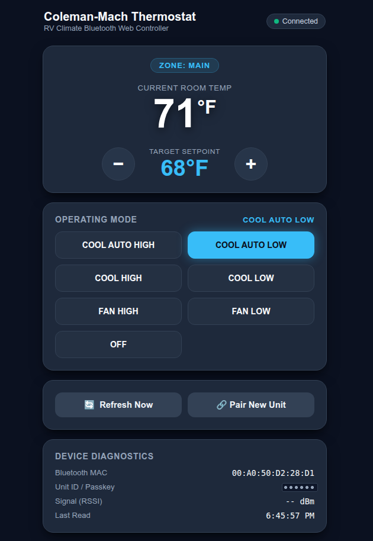

# BreezyMach 🚐❄️
**Compatible Engineered Bluetooth controller and local web dashboard for Coleman-Mach RV thermostats**

[](https://www.rust-lang.org/)
[](https://www.python.org/)
[](LICENSE)
[](#)
[](#)

BreezyMach is a lightweight, local-only Linux tool and web dashboard for monitoring and controlling **Coleman-Mach / Airxcel Bluetooth RV Thermostats**. It runs 100% offline inside your RV without any cloud accounts, proprietary gateways, or internet access. Available both as a high-performance **native Rust single binary** and as a **Python service**.

<p align="center">
  
</p>

---

## 🌟 Key Features

- **📱 Ultra-Responsive Web Dashboard**: Clean dark-mode dashboard tailored for phones, tablets, and RV touchscreens.
- **⚡ Zero-Lag Instant Controls (0ms Optimistic UI)**: Modes switch immediately on screen and sync to the unit via persistent BLE GATT in ~0.5s.
- **🌡️ Smooth Setpoint Adjustment**: Rapid `+` / `−` temperature adjustments with automatic 400ms debounce.
- **🔗 In-Browser Pairing**: Step-by-step visual instructions to enroll new thermostats and whitelist your Linux computer.
- **💻 Full-Featured CLI**: Control and poll the thermostat via terminal or system scripts (`coleman_mach_cli.py`).
- **🌐 REST API**: JSON endpoints for Home Assistant, Node-RED, or custom automation scripts.
- **🏕️ 100% Offline**: Self-contained CSS and SVG icons—zero external CDNs or internet required.

---

## 📖 Protocol & Architecture

BreezyMach communicates directly with the physical thermostat hardware using standard Bluetooth Low Energy (BLE) GATT characteristics.

### Architecture Highlights:

1. **GATT Services & Characteristics**:
   - Communicates with primary GATT service `c9282723-4680-491b-a904-c066fa81061f` across 7 standard characteristics for room temperature, setpoint, mode, status, and device metadata.
2. **Link-Layer Whitelist Handling**:
   - In normal operation, the thermostat advertises `Mfg 0xFFFF: 0x00` and enforces a hardware whitelist filter policy.
   - Holding **UP + DOWN** on the physical thermostat for 5 seconds switches the advertisement to `0xAA` (`PAIRING_OPEN`), opening the whitelist for enrollment.
3. **Automated BlueZ Passkey Agent**:
   - When entering pairing mode, the thermostat LCD flashes its unique 6-digit Unit ID (flashing 2 digits at a time).
   - BreezyMach registers a BlueZ D-Bus `org.bluez.Agent1` that automatically answers Bluetooth SMP pairing passkey requests, seamlessly completing bonding and whitelist enrollment.
4. **Persistent Low-Latency Connection**:
   - Direct MAC addressing and persistent GATT sessions eliminate BLE discovery scan delays, bringing command round-trip times down to ~0.5 seconds.

---

## 📡 Protocol Specification

### Primary GATT Service: `c9282723-4680-491b-a904-c066fa81061f`

| Feature ID | Characteristic UUID | Access | Wire Format & Semantics |
| :--- | :--- | :---: | :--- |
| `1` | `382b4008-084a-4158-b378-66674091b1e2` | **Read** | **1–2 bytes (`uint8` at `raw[0]`)**: Current ambient room temperature in active scale (°F or °C). `0xFF` (`255`) = uninitialized (`"--"`). |
| `2` / `2011` | `beb89473-05fe-41a0-9896-2c082660f19a` | **Read / Write** | **7-byte ASCII string**: Zone name (e.g. `"Main   "`). Space-padded on write. |
| `3` / `2013` | `09996813-fe7d-48ce-9b47-11634c80263c` | **Read / Write** | **1 byte (`uint8`)**: Target setpoint temperature (33..99°F or 1..37°C). |
| `4` | `0575cdb7-d448-4bff-bc53-3b900d2a829f` | **Read** | **10-byte bit-array**: Enabled operating modes shifted into a 10-bit mask. |
| `5` | `3016e3fc-1dbb-455e-b268-80750e36c950` | **Read** | **1 byte (`uint8`)**: `0x01` = Celsius (`°C`), `0x00` = Fahrenheit (`°F`). |
| `6` / `2012` | `9230a9ef-347c-4645-8fd9-cbb830d714bf` | **Read / Write** | **14–15 byte ASCII string**: Active operating mode (e.g. `"COOL AUTO HIGH"`, `"OFF"`). |
| `7` | `e21b2b2c-379e-4166-b835-c71ef7eadfdf` | **Read** | **3 bytes**: 6-digit decimal unit identifier and BLE SMP pairing passkey. |

---

## 🦀 Rust Native Binary (Zero Dependencies)

BreezyMach includes a high-performance **native Rust** implementation (`breezy-mach`). The complete HTML/CSS/JS web dashboard is compiled directly into a single standalone binary (~7.5 MB) with sub-second startup, low memory footprint (~10-15 MB RAM vs ~60 MB in Python), and direct BlueZ D-Bus integration via Tokio and Bluer.

### Building from Source
```bash
cd rust
cargo build --release
# The compiled standalone binary is in rust/target/release/breezy-mach
```

### Running the Rust Web Server
```bash
./breezy-mach serve --port 8050
```

### Rust CLI Commands
```bash
# Get instant status (cached 5m idle state, or --fresh for live BLE GATT read)
./breezy-mach status
./breezy-mach status --fresh --json

# Set temperature and mode
./breezy-mach set --temp 72 --mode "COOL AUTO LOW"
./breezy-mach set --mode OFF

# Scan for Coleman-Mach units
./breezy-mach scan

# Pair a new thermostat with flashing PIN
./breezy-mach pair --pin 123456

# Continuous real-time monitor (default 60s interval)
./breezy-mach monitor --interval 60
```

---

## 🐍 Python Quickstart

### Prerequisites
- Linux computer with Bluetooth 4.0+ (Raspberry Pi, Linux laptop, RV home server).
- Python 3.9+ with `bleak`, `dbus-fast`, and `aiohttp`.

```bash
git clone https://github.com/chieftechnicalwizard/breezy-mach.git
cd breezy-mach
pip install -r requirements.txt
```

### 1. Launch the Web Dashboard
```bash
./web_app.py --port 8050
```
Open **`http://localhost:8050/`** (or your RV server's local IP) on your phone or computer.

### 2. Pairing a New Unit
If pairing for the first time:
1. Open the dashboard and click **🔗 Pair New Unit**.
2. Stand near your thermostat, press and hold **BOTH the UP and DOWN** buttons for **5 seconds** until the screen flashes its 6-digit PIN.
3. Enter the PIN in the modal and click **Start Pairing**.
4. BreezyMach will pair, save the configuration to `~/.config/coleman_mach_ble.json`, and connect automatically from then on.

---

## 🛠️ CLI Usage (`coleman_mach_cli.py`)

BreezyMach includes a standalone command-line tool for terminal automation and scripts:

```bash
# Scan for thermostats
./coleman_mach_cli.py scan

# Read current status (human readable or JSON)
./coleman_mach_cli.py status
./coleman_mach_cli.py --json status

# Change temperature and mode
./coleman_mach_cli.py set --temp 72 --mode "COOL AUTO LOW"

# Turn thermostat off
./coleman_mach_cli.py set --mode OFF

# Continuous live monitoring (poll every 60 seconds)
./coleman_mach_cli.py monitor --interval 60
```

---

## 🏡 Home Assistant Integration

BreezyMach integrates seamlessly with Home Assistant via two methods:

### Option 1: Native MQTT Auto-Discovery (Recommended — Zero HA YAML Required)

When started with `--mqtt-host`, BreezyMach connects to your MQTT broker (e.g. Mosquitto on Home Assistant) and automatically publishes Home Assistant MQTT Discovery topics:

```bash
# Start BreezyMach with MQTT discovery enabled
./breezy-mach serve --port 8050 --mqtt-host 192.168.1.100
```

#### What Home Assistant Discovers Automatically:
* **`climate.rv_thermostat`**: Native interactive thermostat dial with target setpoint, current room temperature, HVAC modes (`off`, `cool`, `fan_only`), and fan modes (`auto_high`, `auto_low`, `high`, `low`).
* **`sensor.rv_room_temperature`**: Ambient temperature sensor with history graphs.
* **`breezy_mach/availability`**: Online/offline device state tracking.

---

### Option 2: Direct Home Assistant REST Template

If you do not use MQTT, you can connect Home Assistant directly to BreezyMach's REST API (`http://192.168.1.50:8050`) by adding the following to your Home Assistant `configuration.yaml`:

```yaml
# In Home Assistant configuration.yaml:
rest_command:
  rv_thermostat_set:
    url: "http://192.168.1.50:8050/api/set"
    method: POST
    headers:
      content-type: "application/json"
    payload: '{"temp": {{ temp | default("null") }}, "mode": "{{ mode | default("") }}"}'

sensor:
  - platform: rest
    name: "RV Thermostat Status"
    resource: "http://192.168.1.50:8050/api/status"
    json_attributes_path: "$.state"
    json_attributes:
      - temperature
      - set_point
      - current_mode
      - zone_name
    value_template: "{{ value_json.state.current_mode }}"
    scan_interval: 300

climate:
  - platform: template
    climates:
      rv_thermostat:
        friendly_name: "RV Thermostat"
        current_temperature_template: "{{ states.sensor.rv_thermostat_status.attributes.temperature }}"
        target_temperature_template: "{{ states.sensor.rv_thermostat_status.attributes.set_point }}"
        hvac_mode_template: >
          
          coolfan_onlyoff
        hvac_modes:
          - "off"
          - "cool"
          - "fan_only"
        set_temperature:
          service: rest_command.rv_thermostat_set
          data:
            temp: "{{ temperature }}"
        set_hvac_mode:
          service: rest_command.rv_thermostat_set
          data:
            mode: >
              COOL AUTO LOWFAN LOWOFF
```

---

## 🔌 REST API Reference

| Method | Endpoint | Description |
| :--- | :--- | :--- |
| `GET` | `/api/status` | Read current status (returns 300s cached idle state; `?fresh=true` forces live BLE GATT read) |
| `POST` | `/api/set` | Set target setpoint, mode, or zone (e.g. `{"temp": 72, "mode": "COOL AUTO LOW"}`) |
| `GET` | `/api/scan` | Scan for nearby Coleman-Mach BLE units |
| `POST` | `/api/pair` | Initiate background pairing sequence (`{"pin": "123456", "wait": 60}`) |
| `GET` | `/api/pair/status` | Get active pairing progress |
| `GET` | `/api/config` | Read saved configuration |

---

## 🧠 Engineering & Hardware Lessons Learned

1. **Preventing BLE Radio Hammering & `0xFF` (`--`) Room Temperature Desync**:
   - **Symptom**: After several days of continuous 15-second BLE connect/read/disconnect polling (~5,760 cycles/day), the thermostat continues to accept setpoint and mode writes normally, but GATT characteristic `382b4008-084a-4158-b378-66674091b1e2` (`ROOM_TEMPERATURE_CHAR_UUID`) begins returning raw bytes `[0xFF, 0x00]` (`[255, 0]`), which decodes to `null` (`--` in the UI).
   - **Root Cause**: The Coleman-Mach Bluetooth wall thermostat uses a dual-MCU architecture—a main HVAC/LCD microcontroller (reading the NTC thermistor) connected via internal serial link to a Microchip (`00:A0:50` OUI) BLE module that caches the 7 GATT characteristics. Hammering the BLE module with back-to-back GATT connections every 15 seconds eventually wedges the internal MCU-to-BLE temperature register update at its uninitialized sentinel (`0xFF`), and the thermostat firmware itself drops idle BLE connections after ~10 seconds.
   - **Software Mitigation**: BreezyMach uses a **5-minute (`300s`) idle state cache TTL** across the REST API, Web UI, and MQTT publisher, and explicitly disconnects after each GATT transaction (`device.disconnect().await`). This reduces BLE connection cycles by **20×** (from 5,760/day to 288/day) while allowing instant on-demand live reads via the Web UI **🔄 Refresh Now** button (`/api/status?fresh=true`) or CLI `breezy-mach status --fresh`.
   - **Hardware Recovery**: If the wall unit is already stuck reporting `0xFF 0x00` (`--`), switch the unit **off at the breaker and let it sit for 30 minutes or more** (allowing the control board capacitors to fully discharge) before turning the breaker back on. No unscrewing or removal of the thermostat faceplate is needed with this method!

2. **GATT Write With Response (`WriteOp::Request` / `0x12`) Requirement**:
   - Although the thermostat's writable characteristics advertise both `write` and `write-without-response` properties, the Coleman-Mach firmware silently ignores GATT `Write Command` (`0x52`, BlueZ's default for `ch.write()`). All setpoint, mode, and zone writes must explicitly specify `WriteOp::Request` (`0x12` ATT Write Request With Response) via `ch.write_ext(&raw, &write_req)`.

3. **Non-Blocking MQTT `ConnAck` Reconnection**:
   - In `rumqttc`, calling `client.publish().await` inside the `eventloop.poll().await` loop while handling `Event::Incoming(Packet::ConnAck(_))` can deadlock if the bounded `AsyncClient` channel fills before `eventloop.poll()` resumes. `on_connected()` must always be spawned in a separate async task (`tokio::spawn`) so the MQTT event loop continues draining outbound discovery and status packets across broker restarts.

4. **Partial GATT Read Resilience**:
   - If a single BLE characteristic read times out during a GATT poll, blindly replacing fields with empty defaults can wipe cached metadata (`zone_name`, `unit_id`) in `~/.config/coleman_mach_ble.json`. BreezyMach merges partial reads against the last known state and preserves non-empty saved configuration values.

---

## 📄 License

MIT License. Created by [ChiefTechnicalWizard](https://github.com/chieftechnicalwizard).
Not affiliated with or endorsed by Airxcel, Inc. or ICM Controls Corp.
